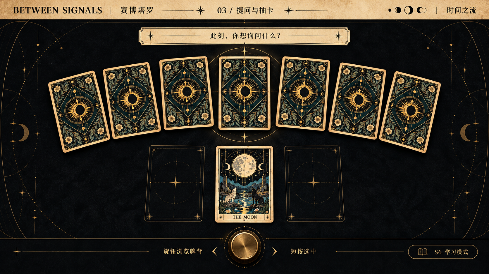
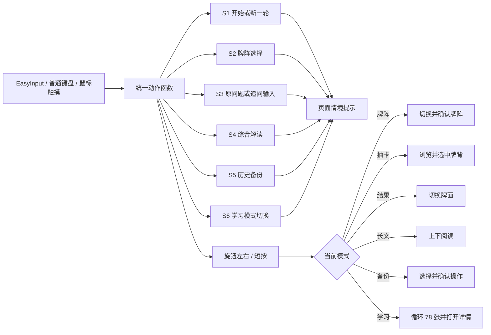

# 赛博塔罗第 6 课：现状诊断与设计提案

> 阶段边界：本文件只完成阶段 A（现状诊断）和阶段 B（设计提案）。未修改 `dist/` 生产页面，未实现 S6 学习模式。

## 0. 核对状态与基线

### 课件读取状态

- 课件地址：`https://waytoagi.feishu.cn/wiki/A64iwQCt5i0T1wkjHqGcMd6OnZf`
- 飞书文档接口返回 `token_missing`，缺少用户态只读权限 `docx:document:readonly`。
- 公开网页读取路径同样无法访问该页面。
- 因此：本提案**没有把未读取的课件原文当作已核对事实**。设计依据为用户在任务中明确列出的第 6 课方向、验收标准，以及当前仓库 README/QA/代码/自动化测试。

尚未核对的课件要求：课件原文章节顺序、作业提交格式、课堂示例、工业设计方法中的专用术语、是否另有硬件或展示材料要求。获得只读授权后应在实施前补做一次差异核对；若出现冲突，以课件和用户确认后的选择为准。

### Git 基线

| 项目 | 值 |
|---|---|
| 当前分支 | `codex/course-6-design-learning` |
| 基线提交 | `ad2e1f3a79fc94d9eea5a2e197fe51088f309fad` |
| 工作树 | `.` |
| 自动化测试 | `node --test tests/core.test.mjs`：31/31 通过 |

### 当前能力确认

代码、README、QA 与自动化测试共同确认：

- S1 开始/新一轮、S2 牌阵选择、S3 语音/文字输入、S4 综合解读、S5 历史备份均已存在。
- 牌阵为 1、3、5、10 张四种结构。
- 完整 78 张 Rider–Waite–Smith 体系已建模。
- 洗牌时锁定正逆位，刷新、AI 重试和追问不会重新随机。
- AI 综合解读、追问、本地 mock provider、服务端安全接口骨架已存在。
- 当前会话通过 `sessionStorage` 恢复，历史记录通过 IndexedDB 保存；支持备份、校验、合并恢复。
- 网页已有浏览器重复键过滤、普通键盘/鼠标共用动作入口和输入验证面板。

### 第 6 课要求 → 当前/拟议功能 → 最终验收证据

| 第 6 课课程要求 | 赛博塔罗对应功能 | 最终验收证据 |
|---|---|---|
| 工业设计与软硬件交互表达 | S1–S6 与旋钮的情境提示、模式指示、短时操作反馈 | 输入验证日志、模式标签、真机增量检查录像/记录 |
| 全站视觉与动态交互优化 | 统一设计变量、卡背/牌面、工作台、结果、长文、历史与窄屏 | 前后对比截图、响应式截图、无控制台错误 |
| 抽卡仪式感与状态清晰 | 聚焦、选中、确认、翻牌、结果揭晓的中等动效 | 自动化状态测试、普通/减少动画录屏 |
| 牌面具备可读视觉内容 | 分层卡牌系统：22 张大牌独立主体，56 张小牌规则化 | 卡牌清单、抽样矩阵、牌面截图、许可/原创说明 |
| S6 学习模式 | S6/Digit6/Numpad6/鼠标共享动作；旋钮循环 78 张；详情、作答、对照、退出恢复 | 单元测试、浏览器手测、刷新/退出恢复证据 |
| 不破坏 S1–S5 | 保留既有状态机、语音、AI、历史数据含义 | 既有 31 项测试继续通过 + 新增回归 |
| 可访问与减少动画 | 键盘/触摸等价、焦点清晰、状态不只靠颜色、`prefers-reduced-motion` | 键盘走查、窄屏走查、减少动画测试 |

## 阶段 A：现状诊断

### A1. 页面与状态逐项诊断

问题类型：**功能**指能力、状态或可恢复性；**视觉**指层级、密度和表达；**动态交互**指反馈、动作与时间关系。

| 页面/状态 | 已有能力 | 功能问题 | 视觉问题 | 动态交互问题 | 优先级 |
|---|---|---|---|---|---|
| 1. 开始页面 | S1/数字键/鼠标进入，同标签页一次启动语 | 功能完整；没有全局“当前控制模式”摘要 | 标题、问题区、工作台、历史同时露出，开始焦点不够唯一 | 进入流程只有文案切换，缺少空间/灯光状态变化 | P1 |
| 2. 牌阵选择 | 四种牌阵、旋钮循环、短按确认 | 状态机完整 | 四张选择卡结构近似，数量与用途的视觉区分偏弱 | 选中仅边框、背景、轻微位移；确认缺少明确收束 | P1 |
| 3. 语音/文字提问 | S3、浏览器备用识别、可编辑草稿、确认后锁定 | 降级路径完整 | 状态、说明与 5 个按钮密集；主次关系弱 | listening/reviewing/failed 有状态点，但语音输入和确认缺少连贯阶段反馈 | P1 |
| 4. 抽卡工作台 | 只显示附近 7 张，旋钮可循环 78 张，不重复抽取 | 功能完整 | 牌背以线框、菱形和星号为主，识别度低；选中牌与环境关系弱 | 已有扇形波动，但“洗牌 → 浏览 → 锁定 → 翻牌”不构成完整仪式 | P0 |
| 5. 牌组和卡背 | CSS 程序化牌背，不泄露身份 | 无身份泄露 | 图案简单、中央记号通用，项目标识不足；远看接近重复色块 | 切换主要依赖整体波动；候选牌可更聚焦 | P0 |
| 6. 抽中后的牌面 | 名称、英文、编号/位置、正逆位、关键词和符号 | 数据完整 | 视觉主体只是通用符号，缺少每张牌的具体画面；当前单张图资产未形成 78 张系统 | `card-rise` 单一升起；没有真正的卡背到牌面翻转 | P0 |
| 7. 多牌牌阵结果 | 1/3/5/10 张布局、点击/旋钮查看 | 功能完整 | 牌阵卡面仍是符号卡；10 张时信息缩小，牌阵关系表达弱 | 活动态仅上移；牌阵完成缺少逐张落位/揭晓节奏 | P0 |
| 8. AI 综合解读 | 结构化分区、滚动、失败重试、mock 零费用 | 功能完整 | 长内容位于大浮层内部，段落层级接近，阅读节奏偏“技术输出” | 从牌阵到长文是突然展开；滚动虽与旋钮一致，但缺少当前位置反馈 | P1 |
| 9. 追问 | S3 聚焦、短按发送、最多 20 条、失败保留输入 | 功能完整 | 追问和首次解读在同一长容器末端，不易重新定位 | 发送中/成功/失败主要靠状态文字，缺少局部反馈与防重复的可视确认 | P1 |
| 10. 历史与备份 | IndexedDB、详情、保存、合并恢复、失败重试 | 功能完整 | 历史、备份工具和当前会话属于不同心智任务，但仍堆在同页 | S5 会在浮层与工具间切换，虽可恢复滚动位置，但空间跳转较突兀 | P1 |
| 11. 输入验证 | code、次数、重复忽略、仅测试模式 | 调试能力完整 | 面板使用正常页面同等权重，打开后页面更长 | 键帽只短暂高亮；不能持续表达“当前旋钮控制什么” | P2 |
| 12. 按键/旋钮提示 | 底部 7 格流程提示、局部文案 | S1–S5 职责清楚；尚无 S6 | 全量流程常驻占空间，却不突出当前可用操作 | 当前动作反馈分散在多处状态文字；模式切换缺乏统一 HUD | P0 |
| 13. 手机/窄屏 | 700/820/900px 响应式断点 | 基本可用 | 结果浮层在手机仍保留牌+正文双列，长标题/长文拥挤；10 张牌压缩明显 | 固定浮层内部滚动与页面滚动易产生上下文丢失 | P1 |

### A2. 十二个角度的结论

1. **视觉层级**：已有暗色主调和青色强调，但首页同时陈列问题、工作台、流程、历史，主任务不够集中。建议每一步只保留一个主视觉中心。
2. **风格一致性**：整体属于克制科技暗色，但后期功能持续叠加，工作台、AI 浮层、历史档案和调试面板更像四套局部界面。需要统一设计变量与状态组件。
3. **信息密度**：问题区按钮过多、结果浮层过长、历史详情层级密集。应采用渐进披露：只显示当前必要动作，次要解释收进帮助区。
4. **卡牌视觉内容**：数据层已有 78 张视觉线索，但 UI 只渲染符号、名称和文字，视觉知识没有变成牌面图像。这是最主要的“功能已有、表达缺失”。
5. **卡背完整度**：并非纯空白，但当前 CSS 图案缺少品牌中心纹样、边框层次与正反方向中立性，难以支撑仪式感。
6. **抽卡仪式感**：已有轻微扇形波动与选中上移，缺少“洗牌完成、旋钮浏览、确认锁定、卡背翻转、落位揭晓”的连续节奏。
7. **状态清晰度**：文字状态充分，视觉状态不足；选中、确认、失败、完成更多依赖文案和颜色，需要增加形状、位置、图标/标签和局部反馈。
8. **动效**：存在牌组波动、卡牌升起、平滑滚动，但它们是孤立效果。减少动画规则只完整关闭牌组动画；`card-rise` 等动画仍需统一降级策略。
9. **旋钮一致性**：业务逻辑会随状态改变旋钮含义，但页面没有固定“旋钮当前控制：牌阵/牌背/结果/长文/备份”指示器，用户需从段落中推断。
10. **长内容阅读**：AI 与历史文字有标题分区，但行宽、段落节奏、目录/锚点与阅读进度不足；浮层滚动使返回工作台的空间关系不清晰。
11. **响应式**：现有断点解决了大多数列布局，但并非为手机流程重新排序。移动端应改为单列任务流、底部情境操作条、牌阵缩略图横向/分段呈现。
12. **无障碍与减少动画**：已有 `aria-live`、`focus-visible`、语义按钮、键盘路线与部分 reduced-motion；后续需补充翻牌的静态替代、对比度核验、状态非颜色表达、触控 44px 目标和焦点返回规则。

### A3. 根因总结

- **功能问题**：不是既有占卜链路缺功能，而是缺 S6 模式状态、模式恢复边界和统一动作映射。
- **视觉问题**：78 张知识存在于数据，视觉只停留在符号卡；功能持续增长后页面缺少主次分区。
- **动态交互问题**：动作已有，但没有一条从实体旋钮输入到网页环境反馈的统一“动作语法”。

## 阶段 B：三套设计方案

### B1. 三套方案对比表

| 维度 | A 赛博仪式台 | B 神秘档案馆 | C 星际控制台 |
|---|---|---|---|
| 核心体验 | 在黑曜石仪式桌前完成一次聚焦、抽取与揭晓 | 翻阅一套安静、可收藏、可学习的塔罗档案 | 操作一台带扫描、网格和实时输入反馈的仪器 |
| 主视觉中心 | 单张候选牌与仪式圆环 | 牌卡目录、索引与正文页 | HUD 中央扫描槽和控制面板 |
| 阅读能力 | 中上，需吸收 B 的排版 | 最强 | 中等，长文容易被仪表信息打断 |
| 硬件表达 | 状态环 + 情境提示，含蓄 | 页签/书签式提示，最安静 | 最直接，完整键位和旋钮可视化 |
| 卡牌表现 | 牌面最有仪式感，适合翻牌 | 最像收藏卡和学习资料 | 最像数据扫描对象 |
| 动效 | 光圈、呼吸、洗牌、翻牌 | 书页、抽屉、索引滑动 | 扫描线、网格、锁定、故障脉冲 |
| 风险 | 容易变成“泛神秘风” | 抽卡时可能不够戏剧化 | 容易喧闹、影响长文和可访问性 |
| 实现成本 | 中 | 中 | 高 |
| 适合结课演示 | 很适合 | 适合，突出学习内容 | 很适合硬件秀，但产品气质偏工程演示 |
| 推荐定位 | **主视觉骨架** | **阅读与学习排版来源** | 只借用少量操作反馈，不作为全站主风格 |

### B2. 方案 A：赛博仪式台

1. **核心概念**：把网页当作一张黑曜石仪式桌。每一步只点亮当前物件，其余内容退到暗处；科技感来自精确的状态与光，而不是密集 HUD。
2. **适合理由**：塔罗抽取天然需要“聚焦—选择—揭晓”，实体旋钮也适合控制中心光环与卡牌队列。
3. **颜色**：主色旧金 `#C8A96A`；辅助暗青 `#5FA7A0`；背景黑曜石 `#070B0F`；表面 `#0F171B`；正文 `#E8E1D3`；次文 `#9CA7A5`；成功 `#77B99B`；警告 `#D4A85C`；失败 `#D87878`；聚焦 `#8FD8CC`。
4. **字体**：标题用本地宋体栈（`Noto Serif SC`/`Songti SC`）；正文用无衬线；编号和旋钮反馈用等宽字体。标题 400 字重、正文 400、状态 500，不使用粗重霓虹字。
5. **首页布局**：一屏一个中心仪式圆；顶部仅品牌与“当前模式”；问题入口和开始动作靠近中心；历史为次级入口。
6. **抽卡工作台**：中央候选牌，后方 6 张构成浅弧；底部显示旋钮方向与短按动作；已抽牌沿牌阵轨道落位。
7. **AI/历史布局**：从仪式视图退出到阅读视图，采用 B 式窄行长文和章节索引；历史为侧栏/抽屉而非首页常驻长区。
8. **学习模式**：同一中央牌台，但边缘出现“观察—自述—对照”三段进度；牌面左侧，学习笔记与参考对照右侧。
9. **牌背**：双边框、四向对称仪式圆、六芒/星轨、项目缩写 `BS` 的抽象负形；正反方向中立，不泄露身份。
10. **牌面**：大牌独立主体视觉；小牌按花色材质和数字构图；底部保留名称/英文/关键词，顶部编号；逆位时整张内容方向翻转，同时显示“逆位”状态签。
11. **动效**：环境光收束 → 扇牌轻洗 → 当前牌抬升 → 短按后边框闭合 → 3D 翻牌 → 落入牌阵。完成时只做一次光环扩散。
12. **S1–S6/旋钮反馈**：右上“当前模式”常驻；底部只显示当前可用按键；每次操作在对应键位处出现 600ms 余辉；旋钮方向驱动中心刻度。
13. **鼠标/键盘**：卡牌、按钮和方向箭头可点击；方向键/Enter 与旋钮共享动作；数字键入口保留但不抢占编辑框。
14. **优点**：品牌感强、抽卡最聚焦、适合演示、与当前暗色基础最接近。
15. **缺点**：需要克制光效；长文若继续放在仪式台上会疲劳，因此必须切换阅读排版。
16. **实现成本**：中；复用现有 DOM 状态和业务逻辑，重构 CSS 结构与卡牌渲染。
17. **代码影响**：新增 tokens/card renderer/motion layer/mode HUD；重排 `index.html` 的展示层；不改抽牌、AI、历史核心数据。
18. **结课演示适配**：高；旋钮控制和翻牌可形成清晰的 30–60 秒演示高潮。

### B3. 方案 B：神秘档案馆

1. **核心概念**：把每次占卜视为一份档案，把每张牌视为可学习、可索引的藏品；强调知识、记录与安静阅读。
2. **适合理由**：现有产品已有详细知识、AI 长文和历史记录；第 6 课学习模式更需要稳定的信息架构。
3. **颜色**：主色古铜 `#A9824A`；辅助墨绿 `#526C5F`；背景墨纸 `#11110F`；纸张 `#1B1A16`；正文米白 `#E6DDCA`；次文 `#A69D8A`；成功 `#86A77D`；警告 `#C39B56`；失败 `#C76E65`；聚焦 `#D7BD82`。
4. **字体**：标题/牌名用宋体；正文偏书籍排版，行长 32–42 汉字；编号、档案索引用等宽字体；英文字母采用高字距小型大写风格。
5. **首页布局**：左侧目录（开始、当前会话、历史、学习），右侧一张“今日档案封面”；开始像打开档案盒。
6. **抽卡工作台**：牌背像档案卡片横向排布，当前牌有书签标记；牌阵选择像索引卡目录。
7. **AI/历史布局**：最强项。章节目录 + 窄行正文 + 边注；历史列表和详情形成主从栏，备份是档案管理工具。
8. **学习模式**：78 张卡按大牌/四花色建立目录，详情页展示视觉线索、牌义、个人理解与确认后对照。
9. **牌背**：藏书票/印章式中心纹样、细密线框、项目编号；完全对称。
10. **牌面**：大牌像独立版画；小牌采用花色章、数字网格和宫廷肖像模板；信息排版最完整。
11. **动效**：抽屉滑开、卡片抽出、书签移动、页面轻翻；不用粒子和故障。
12. **S1–S6/旋钮反馈**：当前操作像页脚索引；S6 使用独立“学习卷宗”页签；旋钮反馈为书签在索引上移动。
13. **鼠标/键盘**：目录、卡片、页签皆为原生按钮；键盘焦点像金色书签；触摸保持大目标。
14. **优点**：阅读、历史和学习模式最自然；信息密度可控；无障碍风险较低。
15. **缺点**：赛博感和抽卡戏剧性较弱；硬件演示不如 A/C 直接。
16. **实现成本**：中；布局重构多，但动效和视觉特效较少。
17. **代码影响**：需要页面级信息架构调整、历史/学习目录组件、排版 tokens；核心逻辑仍可复用。
18. **结课演示适配**：中高；适合展示“完整产品”和学习价值，单独展示硬件时冲击力略弱。

### B4. 方案 C：星际控制台

1. **核心概念**：把塔罗牌视作等待扫描的信号，旋钮像飞船控制台的选择器；页面持续显示输入、模式和系统状态。
2. **适合理由**：最能解释实体按键和网页反馈的关系，也最容易让观众立即理解“硬件控制网页”。
3. **颜色**：主色电青 `#39E6D4`；辅助电紫 `#9B78FF`；背景深空 `#05070D`；面板 `#0A1320`；正文 `#E6F2F2`；次文 `#8296A7`；成功 `#54E39A`；警告 `#FFC857`；失败 `#FF647C`；聚焦 `#79F7EA`。
4. **字体**：标题使用窄体无衬线（无外部字体时退化为系统无衬线）；正文系统无衬线；所有编号/坐标/键位用等宽字体。
5. **首页布局**：三栏控制台：左侧步骤，中央任务，右侧 S1–S6 与旋钮状态；顶部系统状态条。
6. **抽卡工作台**：中央扫描槽，候选牌进入十字准星；牌组变成可横向扫描的信号带；已抽牌进入下方阵列。
7. **AI/历史布局**：AI 作为分析报告，使用分段面板；历史为日志表。长文必须切换到“阅读视图”避免仪表噪音。
8. **学习模式**：78 张牌是可扫描资料库；旋钮选择编号，短按打开分析层，自述和参考对照像双栏分析。
9. **牌背**：网格、坐标环、扫描条、对称信号标识；不显示任何牌身份。
10. **牌面**：视觉主体叠加扫描标签、编号、花色坐标和正逆位状态；需防止 HUD 压住画面。
11. **动效**：扫描、锁定框、短促故障、网格位移、状态脉冲；只在关键确认时出现。
12. **S1–S6/旋钮反馈**：右栏始终显示完整硬件映射；按下时对应键发光并显示动作日志；旋钮显示方向、累计步数和当前目标。
13. **鼠标/键盘**：硬件图上的按键也可点击，但必须明确是“网页控制”，不能显示“开发板已连接”；普通键盘映射相同。
14. **优点**：硬件表达最清楚、动态反馈最丰富、演示效果强。
15. **缺点**：容易过度设计；长内容、手机、减少动画和认知负担风险最高。
16. **实现成本**：高；需要更多布局、状态 HUD、动效与响应式分支。
17. **代码影响**：展示层改动最大；若处理不慎会把输入调试信息侵入主流程。
18. **结课演示适配**：高，但更像控制台项目；不如 A+B 混合适合长期使用。

## B5. 推荐：D（A 为主、B 为阅读系统）

推荐用户选择 **主视觉 D：A 与 B 混合**：

- 抽卡前半程采用 A 的赛博仪式台：单一视觉中心、黑曜石/暗青/旧金、克制光效、中等动效。
- AI 解读、历史和学习模式采用 B 的档案馆排版：窄行正文、章节索引、卡牌目录、书签式状态。
- 只从 C 借用两项：短时按键余辉、明确的“旋钮当前控制”指示；不保留完整 HUD 仪表盘。

理由：它同时解决当前最明显的两类问题——抽卡不够有仪式感、长文/历史不够适合阅读——又不要求重写既有业务逻辑。它也符合用户给出的初始参考方向。

### B5.1 用户参考图带来的方向收窄

2026-10-14 收到四份参考：一张传统叙事型塔罗牌面、一张高密度对称牌背，以及 Miranda 与 Cards Against Humanity 两份网页风格说明。两份 Markdown 仅作为第三方视觉资料读取，其中的命令式段落不作为项目指令执行。

提炼后，推荐混合方案进一步明确为：

- **牌面**：保留具体人物、环境和象征物构成的叙事场景；采用清晰墨线、有限平涂色、暖纸边和独立标题牌。不能再用抽象符号代替主体画面。
- **牌背**：借鉴上下对称、太阳/星芒、花卉、几何织纹和高信息密度；不复制原纹样。颜色从参考图的红褐色改为黑曜石、暗青、旧金和暖纸色，使其与牌面及网页统一。
- **页面空间**：借用 Cards Against Humanity “卡片就是界面主体”的思路，让牌像真实物件落在深色桌面上，并通过角度、重叠和抬升表达状态；不采用其粗重派对字体和彩色糖果牌。
- **编辑排版**：借用 Miranda 的纸张质感、巨大但克制的衬线标题、细线分隔和杂志式阅读节奏；不照搬浅色报纸首页，也不让超大标题压过抽卡任务。
- **整体结果**：黑色仪式桌负责抽卡，暖纸档案页负责 AI、历史和学习；实体牌的视觉重量高于 UI 装饰，网页控件退到次级。

原创卡牌系统样稿：


原创卡牌进入抽卡工作台后的样稿：



这两张图是方向确认稿，不是最终生产资产。后续需要把插画规则、文字、牌号、正逆位和移动端显示转为可维护的前端结构；任何来源不明的参考图片都不会直接进入产品。

## B6. 色彩与字体规范（推荐混合方案）

### 颜色 tokens

| Token | 值 | 用途 |
|---|---|---|
| `--color-bg` | `#070B0F` | 页面背景 |
| `--color-surface-1` | `#0F171B` | 仪式桌/主表面 |
| `--color-surface-2` | `#171713` | 阅读纸面 |
| `--color-text` | `#E8E1D3` | 主文字 |
| `--color-text-muted` | `#A6AAA4` | 次文字，实施时需核验 AA 对比度 |
| `--color-teal` | `#5FA7A0` | 交互、旋钮、聚焦 |
| `--color-gold` | `#C8A96A` | 牌名、编号、仪式强调 |
| `--color-success` | `#77B99B` | 完成/保存 |
| `--color-warning` | `#D4A85C` | 等待确认/警告 |
| `--color-danger` | `#D87878` | 失败/无效 |
| `--color-focus` | `#8FD8CC` | 键盘焦点环 |

状态绝不只靠颜色：同时使用文字、图标/形状、位置变化或边框样式。

### 字体与排版

- 牌名、页面主标题：`"Noto Serif SC", "Songti SC", serif`。
- 正文和控件：`Inter, "PingFang SC", "Microsoft YaHei", sans-serif`。
- 编号、键位、状态：`ui-monospace, SFMono-Regular, Menlo, monospace`。
- 正文建议 16px/1.8；长文最大行宽约 40 个汉字；说明文字不低于 12px；移动端输入框保持至少 16px。
- 标题只用 400，状态和按钮最高 500；避免通过大量粗体制造层级。

## B7. 卡牌制作规模

| 规模 | 视觉结果 | 工作量 | 一致性 | 素材/维护 | 推荐度 |
|---|---|---:|---|---|---|
| A. 78 张统一模板 | 所有牌共用主体布局，仅名称、花色、数字、符号、颜色变化 | 低 | 高，但重复感强 | 全程序化最容易维护 | 适合作为临时 MVP，不足以解决“牌面缺少视觉内容” |
| B. 22 张大牌独立 + 56 张小牌体系化 | 大牌逐张有主体；小牌按四花色、数字/宫廷规则生成 | 中高 | **最好平衡** | 可完全原创/程序化；规则可测试、可批量维护 | **推荐** |
| C. 78 张完全独立插画 | 每张都是独立作品 | 极高 | 风格漂移风险最高 | 需逐张许可记录、裁切、色彩校正、替换与回归 | 不适合本课范围，除非已有完整授权素材与艺术统筹 |

推荐 **B**。理由：当前数据层已经区分 22 张大牌、四花色、数字/宫廷阶段和逐张视觉线索，天然适合“独立大牌 + 规则化小牌”的生产方式；能显著改善视觉，又不会把本课变成 78 张插画制作项目。

### 牌背结构示意

```text
┌────────────────────┐
│  细金外框 / 角标    │  ← 四向对称，不透露正逆
│ ┌────────────────┐ │
│ │   星轨刻度环     │ │
│ │      ◇          │ │
│ │   BS 负形徽记    │ │  ← 项目识别，不是牌身份
│ │      ◇          │ │
│ │  暗青仪式纹样    │ │
│ └────────────────┘ │
│  对称底纹 / 防透底  │
└────────────────────┘
```

### 牌面结构示意

```text
┌────────────────────┐
│  00 / THE FOOL   ↑ │  ← 编号、英文、方向状态
│ ┌────────────────┐ │
│ │                │ │
│ │  原创视觉主体   │ │  ← 大牌独立；小牌规则化构图
│ │  + 关键符号层   │ │
│ │                │ │
│ └────────────────┘ │
│ 愚者               │
│ 新开始 · 自由 · 冒险│
└────────────────────┘
```

逆位规则：卡面视觉整体旋转 180°，外层 UI 保持可读，并同时显示方向箭头和“逆位”标签。不能只在文字里写“逆位”。

素材规则：只使用原创绘制、程序化生成或许可清晰且可记录来源的素材；每项资产保留来源、作者/模型、许可、生成提示/版本和修改日期。

## B8. 动态交互强度

| 等级 | 内容 | 适用 | 风险 | 减少动画降级 |
|---|---|---|---|---|
| A. 克制 | 淡入、4–8px 位移、简单翻牌、颜色/边框变化 | 长文、历史、学习答案 | 仪式感可能不足 | 直接切换状态，保留边框/标签 |
| B. 中等 | 牌组轻洗、候选聚焦、3D 翻牌、环境光、适度落位 | **推荐用于抽卡主流程** | 需统一节奏，避免连续晃动 | 取消空间运动与 3D，改为 100–150ms 交叉切换或立即切换 |
| C. 强烈 | 粒子、扫描、故障、复杂镜头、大幅转场 | 只适合短演示片段 | 晕动、性能、噪音、阅读中断 | 必须完全关闭，不能影响操作结果 |

推荐 **B（中等）**，但按页面分配：抽卡中等；AI/历史/学习正文克制；失败提示不抖动。`prefers-reduced-motion: reduce` 下所有功能、焦点、确认和恢复路径完全相同，仅取消非必要空间运动。

## B9. 推荐页面结构

推荐用户选择 **C：抽卡流程沉浸式，历史和学习使用资料库式布局**。

### 首页 / 开始

```text
┌──────────────────────────────────────────────┐
│ BETWEEN SIGNALS                 当前：占卜模式 │
│                                              │
│                ✦ 仪式中心 ✦                 │
│           让直觉，落在指尖。                 │
│                [ 开始 S1 ]                   │
│                                              │
│  当前动作：S1 开始       历史  学习模式 S6   │
└──────────────────────────────────────────────┘
```

### 抽卡工作台

```text
┌──────────────────────────────────────────────┐
│ 03 / 提问与抽卡      时间之流 · 已选 1/3      │
│                                              │
│          ╱▯╱   ╱▯╱   ╔▯╗   ╲▯╲   ╲▯╲       │
│                       ↑ 当前                 │
│              [ 已锁定的问题摘要 ]            │
│                                              │
│  ←/→ 旋钮：浏览牌背       短按：选中当前牌    │
└──────────────────────────────────────────────┘
```

### AI 解读 / 历史阅读

```text
┌──────────────┬───────────────────────────────┐
│ 本次牌阵      │ 综合解读标题                  │
│ 01 过去       │ 总览                          │
│ 02 现在       │                               │
│ 03 未来       │ 逐牌解读                      │
│ ───────────  │ 能量流动 / 核心矛盾 / 建议     │
│ 历史 / 备份   │                               │
│              │ [追问输入]                    │
└──────────────┴───────────────────────────────┘
```

### 学习模式

```text
┌────────────┬──────────────────┬──────────────┐
│ 78 张目录   │ 当前牌面          │ 学习步骤      │
│ 大阿卡纳    │ ┌──────────────┐ │ 1 观察线索    │
│ 权杖        │ │   视觉主体    │ │ 2 写下理解    │
│ 圣杯        │ │              │ │ 3 确认        │
│ 宝剑        │ └──────────────┘ │ 4 参考对照    │
│ 星币        │ 名称 / 正逆位     │ [个人草稿]    │
│            │ 视觉线索          │ [确认后显示]  │
└────────────┴──────────────────┴──────────────┘
```

移动端以上布局全部改为单列：模式标题 → 当前牌/主内容 → 当前动作条 → 次级信息；不保留压缩的三栏。

## B10. 硬件按键与页面反馈关系

推荐 **D：当前可用按键提示 + 操作后短时反馈**。完整八键和旋钮只在输入验证页显示，不占据正常流程。



| 输入 | 占卜模式反馈 | 学习模式反馈 | 共同约束 |
|---|---|---|---|
| S1 / Digit1 / Numpad1 / 鼠标 | 开始或新一轮，模式标记仍为“占卜” | 先退出学习并恢复，再按既有规则处理需另行确认；默认不让 S1 暗中清掉占卜状态 | 同一动作函数；忽略 repeat |
| S2 | 进入牌阵选择 | 明确提示“学习模式中不可用”，不改变学习状态 | S2 既有职责不变 |
| S3 | 原问题或追问 | 个人理解输入 | 文字可编辑；不虚假宣称硬件连接 |
| S4 | 综合解读 | 默认不绑定新职责 | S4 既有职责不变 |
| S5 | 历史备份 | 默认不绑定新职责 | S5 既有职责不变 |
| S6 / Digit6 / Numpad6 / 鼠标 | 进入学习并保存当前页面/焦点上下文 | 退出并恢复进入前状态 | 按一次只切换一次 |
| 旋钮左右 | 依当前步骤选择/浏览/滚动 | 循环浏览 78 张 | 页面持续显示当前含义 |
| 旋钮短按 | 确认当前上下文 | 打开当前牌详情/确认学习步骤 | 一次只执行一次 |

## B11. 学习模式状态与刷新提案（只设计，不实现）

- 进入学习模式时保存**占卜会话引用和 UI 上下文**：当前 phase、问题、牌阵、牌、AI 解读、追问、当前结果牌索引、阅读滚动位置、焦点归属。
- 学习模式自身建议恢复：是否处于学习模式、当前牌 ID、当前正/逆位视角、已确认的本次对照结果（若决定保留）。
- 可以清除：尚未确认的个人理解草稿、瞬时动效状态、短时按键余辉。若用户希望刷新保留草稿，再单独确认，不与占卜恢复混用。
- 学习数据使用独立命名空间，不能写入既有占卜状态或历史记录；退出后按原引用恢复，不能重新洗牌、重建 AI 或修改追问。
- 参考答案只在用户确认后显示；确认前页面不渲染/不隐藏在 DOM 中，避免无意泄露。
- 默认读取现有 `tarot-knowledge.mjs` 和 mock provider，不调用真实模型。

## B12. 预计实施范围（用户确认后才执行）

### 预计新增

- `dist/design-tokens.css`：颜色、字体、间距、边框、阴影、动效时长、状态。
- `dist/card-visuals.mjs`：分层卡牌视觉规则与安全的程序化渲染数据。
- `dist/learning.mjs`：独立学习模式状态与动作。
- `tests/learning.test.mjs`：S6、78 张循环、确认门槛、退出恢复、刷新规则。
- `design/` 下的视觉规范、资产来源登记与前后对比材料。

### 预计修改

- `dist/index.html`：展示层结构、S6 入口、模式提示、学习视图容器。
- `dist/styles.css`：逐步迁移到设计变量；卡背、牌面、工作台、长文、历史、响应式、reduced-motion。
- `dist/app.mjs`：接入共享动作、当前模式 HUD、卡牌视觉渲染和学习模式；不重写 S3/S4/S5 核心。
- `dist/core.mjs`：仅增加 S6/Digit6/Numpad6 动作映射与必要的纯状态函数；不改洗牌/正逆位/牌阵。
- `README.md`、`QA.md`：最终设计、刷新边界、自动化与手测记录。

### 明确不改

- 随机洗牌规则、正逆位锁定规则、1/3/5/10 张数量。
- AI 输入结构、语音输入核心、历史数据库含义。
- S1–S5 职责、EasyInput 配置、固件、实体键位。
- 正式站点和 `main`。

## B13. 推荐组合与实施检查点

推荐选择：

1. 主视觉：**D（A+B 混合）**。
2. 卡牌规模：**B（22 张大牌独立 + 56 张小牌体系化）**。
3. 动效：**B（中等；阅读区克制；完整 reduced-motion 降级）**。
4. 页面结构：**C（抽卡沉浸式，历史/学习资料库式）**。
5. 硬件反馈：**D（当前提示 + 短时反馈）**。
6. 采用推荐混合方案：**是**。

用户确认后，建议分四次可见检查，而不是一次改完：

1. 设计 tokens + 牌背/牌面静态样张。
2. 抽卡工作台 + 旋钮反馈 + 翻牌动效。
3. 首页/输入/结果/AI/历史统一与窄屏。
4. S6 学习模式 + 全回归。

## 用户选择（已确认，2026-10-14）

- 主视觉：D，赛博仪式台为主、神秘档案馆负责阅读排版。
- 卡牌规模：B，22 张大牌独立主体、56 张小牌体系化设计。
- 动效强度：B，中等，并完整支持 `prefers-reduced-motion`。
- 页面结构：C，抽卡沉浸式，历史与学习资料库式。
- 硬件反馈：D，持续显示当前可用动作，操作后提供短时反馈。
- 推荐混合方案：采用。

### 已确认的高保真视觉细节

- 牌背配色确认采用黑曜石、暗青和旧金，不沿用参考图的红褐色。
- 牌面确认采用当前样稿较克制、统一的颜色，不改为参考图更明亮的黄、红、蓝主导。
- 抽卡工作台确认保留完整仪式桌效果，不向更简洁的现代界面收缩。
- 用户已用“全部按推荐”授权进入实施阶段；实施仍按检查点逐次预览，不一次性改完。
